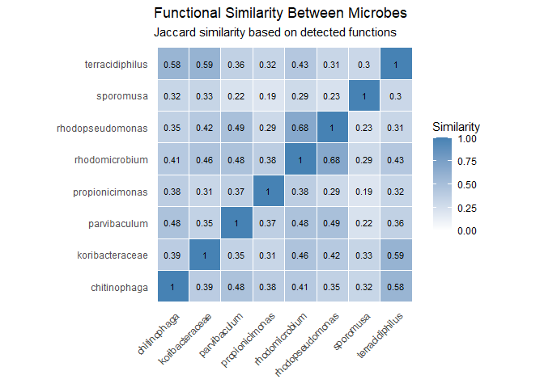
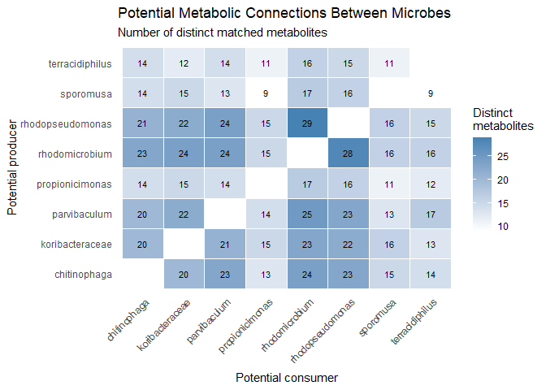

Analysis on Full Community metabolic results
================

- [Import data](#import-data)
- [Check for duplicates](#check-for-duplicates)
- [Initial exploration with outdated column
  names](#initial-exploration-with-outdated-column-names)
- [Create and compare functional
  profiles](#create-and-compare-functional-profiles)
  - [Jaccard similarity](#jaccard-similarity)
- [Identify potential metabolic
  connections](#identify-potential-metabolic-connections)
  - [Pivot data for analysis](#pivot-data-for-analysis)
  - [Summarize potential connections](#summarize-potential-connections)

# Import data

``` r
# Libraries
library(readxl)
library(tidyverse)
library(janitor)
library(dplyr)

metabolic_result_full_community_path <- "../data/METABOLIC_result_full_community.xlsx"

df_HMMHitNum <- read_excel(metabolic_result_full_community_path, sheet = "HMMHitNum")
df_FunctionHit <- read_excel(metabolic_result_full_community_path, sheet = "FunctionHit")
df_KEGGModuleStepHit <- read_excel(metabolic_result_full_community_path, sheet = "KEGGModuleStepHit")
df_dbCAN2Hit <- read_excel(metabolic_result_full_community_path, sheet = "dbCAN2Hit")
df_MEROPSHit <- read_excel(metabolic_result_full_community_path, sheet = "MEROPSHit")
```

``` r
df_HMMHitNum <- df_HMMHitNum %>% 
  clean_names() %>% 
  rename(gene_function = 'function')
```

# Check for duplicates

``` r
# Source - https://stackoverflow.com/a/16907515
# Posted by Kikapp
# Retrieved 2026-10-28, License - CC BY-SA 3.0

n_occur <- data.frame(table(df_FunctionHit$Category))
n_occur[n_occur$Freq > 1,]
```

    ##                                                        Var1 Freq
    ## 1                                    Amino acid utilization    8
    ## 2                                     Aromatics degradation    3
    ## 3                                                As cycling    2
    ## 4                                             C1 metabolism    5
    ## 5                                           Carbon fixation    7
    ## 7                                Complex carbon degradation   17
    ## 8                                      Ethanol fermentation    2
    ## 10                                             Fermentation    6
    ## 12                                             Hydrogenases   15
    ## 14                                       Methane metabolism    3
    ## 16                                         Nitrogen cycling    9
    ## 17                                Oxidative phosphorylation    6
    ## 18 Oxygen metabolism (Oxidative phosphorylation Complex IV)    5
    ## 21                                           Sulfur cycling    7

``` r
n_occur <- data.frame(table(df_FunctionHit$Function))
n_occur[n_occur$Freq > 1,]
```

    ##                               Var1 Freq
    ## 13              Amylolytic enzymes    4
    ## 22             Cellulose degrading    3
    ## 23                Chitin degrading    2
    ## 32              Endohemicellulases    2
    ## 34                FeFe hydrogenase    7
    ## 38       Hemicullulose debranching    3
    ## 48               Ni-Fe Hydrogenase    7
    ## 57 Other oligosaccharide degrading    3

``` r
n_occur <- data.frame(table(df_FunctionHit$Gene.abbreviation))
n_occur[n_occur$Freq > 1,]
```

    ## [1] Var1 Freq
    ## <0 rows> (or 0-length row.names)

Category and Function columns have duplicates, but Gene.abbreviation
doesn’t.

# Initial exploration with outdated column names

``` r
# Filter out functions that are absent in all
# df_present_functions <-
#   df_HMMHitNum %>%
#   filter(
#     `1Presence` == "Present" |
#     `2Presence` == "Present" |
#     `3Presence` == "Present" |
#     `4Presence` == "Present" |
#     `5Presence` == "Present" |
#     `6Presence` == "Present" |
#     `7Presence` == "Present" |
#     `8Presence` == "Present"
#   )
```

``` r
# Functions that all have
# df_all_present <-
#   df_HMMHitNum %>% 
#   filter(
#     `1Presence` == "Present" &
#     `2Presence` == "Present" & 
#     `3Presence` == "Present" & 
#     `4Presence` == "Present" & 
#     `5Presence` == "Present" & 
#     `6Presence` == "Present" & 
#     `7Presence` == "Present" & 
#     `8Presence` == "Present"
#   )
# df_all_present %>% 
#   select(Function)
```

# Create and compare functional profiles

``` r
df_presence_matrix <- df_FunctionHit %>%
  select(
    Gene.abbreviation,
    ends_with("Function.presence")
  ) %>%
  mutate(
    across(
      ends_with("Function.presence"),
      ~ as.integer(.x == "Present")
    )
  ) %>%
  rename_with(
    ~ str_remove(.x, "\\.Function\\.presence$"),
    ends_with("Function.presence")
  )

presence_matrix <- df_presence_matrix %>%
  select(-Gene.abbreviation) %>%
  as.matrix() %>%
  `rownames<-`(df_presence_matrix$Gene.abbreviation)
```

## Jaccard similarity

``` r
library(vegan)
```

    ## Warning: package 'vegan' was built under R version 4.5.3

    ## Loading required package: permute

    ## Warning: package 'permute' was built under R version 4.5.3

``` r
# Rows = microbes; columns = functions
microbe_matrix <- t(presence_matrix)

# Jaccard similarity
jaccard_similarity <- 1 - as.matrix(
  vegdist(microbe_matrix, method = "jaccard", binary = TRUE)
)

round(jaccard_similarity, 2)
```

    ##                  chitinophaga koribacteraceae parvibaculum propionicimonas
    ## chitinophaga             1.00            0.39         0.48            0.38
    ## koribacteraceae          0.39            1.00         0.35            0.31
    ## parvibaculum             0.48            0.35         1.00            0.37
    ## propionicimonas          0.38            0.31         0.37            1.00
    ## rhodomicrobium           0.41            0.46         0.48            0.38
    ## rhodopseudomonas         0.35            0.42         0.49            0.29
    ## sporomusa                0.32            0.33         0.22            0.19
    ## terracidiphilus          0.58            0.59         0.36            0.32
    ##                  rhodomicrobium rhodopseudomonas sporomusa terracidiphilus
    ## chitinophaga               0.41             0.35      0.32            0.58
    ## koribacteraceae            0.46             0.42      0.33            0.59
    ## parvibaculum               0.48             0.49      0.22            0.36
    ## propionicimonas            0.38             0.29      0.19            0.32
    ## rhodomicrobium             1.00             0.68      0.29            0.43
    ## rhodopseudomonas           0.68             1.00      0.23            0.31
    ## sporomusa                  0.29             0.23      1.00            0.30
    ## terracidiphilus            0.43             0.31      0.30            1.00

``` r
jaccard_similarity %>%
  as.data.frame() %>%
  rownames_to_column("microbe1") %>%
  pivot_longer(
    cols = -microbe1,
    names_to = "microbe2",
    values_to = "similarity"
  ) %>%
  ggplot(aes(x = microbe1, y = microbe2, fill = similarity)) +
  geom_tile(color = "white") +
  geom_text(aes(label = round(similarity, 2)), size = 3) +
  coord_equal() +
  scale_fill_gradient(
    low = "white",
    high = "steelblue",
    limits = c(0, 1)
  ) +
  labs(
    title = "Functional Similarity Between Microbes",
    subtitle = "Jaccard similarity based on detected functions",
    x = NULL,
    y = NULL,
    fill = "Similarity"
  ) +
  theme_minimal() +
  theme(
    axis.text.x = element_text(angle = 45, hjust = 1),
    panel.grid = element_blank()
  )
```

<!-- -->

``` r
df_presence_matrix %>%
  filter(chitinophaga == 1) %>%
  select(Gene.abbreviation)
```

    ## # A tibble: 29 × 1
    ##    Gene.abbreviation                                                         
    ##    <chr>                                                                     
    ##  1 4-aminobutyrate aminotransferase and related aminotransferases            
    ##  2 phosphoserine aminotransferase                                            
    ##  3 ornithine/acetylornithine aminotransferase                                
    ##  4 branched-chain amino acid aminotransferase/4-amino-4-deoxychorismate lyase
    ##  5 aspartate/tyrosine/aromatic aminotransferase                              
    ##  6 histidinol-phosphate/aromatic aminotransferase                            
    ##  7 ubiX||bsdC                                                                
    ##  8 cellulase                                                                 
    ##  9 beta-glucosidase                                                          
    ## 10 arabinosidase                                                             
    ## # ℹ 19 more rows

``` r
df_presence_matrix
```

    ## # A tibble: 104 × 9
    ##    Gene.abbreviation   chitinophaga koribacteraceae parvibaculum propionicimonas
    ##    <chr>                      <int>           <int>        <int>           <int>
    ##  1 rgy                            0               0            0               0
    ##  2 4-aminobutyrate am…            1               1            1               0
    ##  3 aminotransferase c…            0               1            0               0
    ##  4 phosphoserine amin…            1               0            1               1
    ##  5 ornithine/acetylor…            1               1            1               1
    ##  6 branched-chain ami…            1               1            1               1
    ##  7 aspartate/tyrosine…            1               1            0               1
    ##  8 histidinol-phospha…            1               1            1               1
    ##  9 serine-pyruvate am…            0               1            0               0
    ## 10 acetate => acetald…            0               1            0               0
    ## # ℹ 94 more rows
    ## # ℹ 4 more variables: rhodomicrobium <int>, rhodopseudomonas <int>,
    ## #   sporomusa <int>, terracidiphilus <int>

# Identify potential metabolic connections

## Pivot data for analysis

``` r
presence_long <- df_HMMHitNum %>%
  select(
    gene_abbreviation,
    ends_with("_hmm_presence")
  ) %>%
  pivot_longer(
    cols = ends_with("_hmm_presence"),
    names_to = "microbe",
    names_pattern = "(.*)_hmm_presence",
    values_to = "presence"
  ) %>%
  mutate(
    present = as.integer(presence == "Present")
  )
```

``` r
# 1. Create a table of detected functions and their reactions
reaction_info <- df_HMMHitNum %>%
  mutate(function_id = row_number()) %>%
  select(
    function_id,
    gene_abbreviation,
    reaction,
    substrate,
    product
  )

# 2. Identify the functions detected in each microbe
detected_functions <- presence_long %>%
  filter(present == 1) %>%
  left_join(
    reaction_info,
    by = "gene_abbreviation"
  )
```

    ## Warning in left_join(., reaction_info, by = "gene_abbreviation"): Detected an unexpected many-to-many relationship between `x` and `y`.
    ## ℹ Row 187 of `x` matches multiple rows in `y`.
    ## ℹ Row 2 of `y` matches multiple rows in `x`.
    ## ℹ If a many-to-many relationship is expected, set `relationship =
    ##   "many-to-many"` to silence this warning.

``` r
# 3. Expand products into one metabolite per row
producers <- detected_functions %>%
  filter(!is.na(product), product != "N/A") %>%
  separate_longer_delim(product, delim = ";") %>%
  mutate(metabolite = str_trim(product)) %>%
  filter(
    !is.na(metabolite),
    metabolite != "",
    metabolite != "N/A"
  ) %>%
  select(
    producer = microbe,
    produced_by = gene_abbreviation,
    metabolite
  )

# 4. Expand substrates into one metabolite per row
consumers <- detected_functions %>%
  filter(!is.na(substrate), substrate != "N/A") %>%
  separate_longer_delim(substrate, delim = ";") %>%
  mutate(metabolite = str_trim(substrate)) %>%
  filter(
    !is.na(metabolite),
    metabolite != "",
    metabolite != "N/A"
  ) %>%
  select(
    consumer = microbe,
    consumed_by = gene_abbreviation,
    metabolite
  )

# 5. Match potential producer-consumer pairs
candidate_links <- producers %>%
  inner_join(consumers, by = "metabolite") %>%
  filter(producer != consumer) %>%
  distinct() %>%
  arrange(metabolite, producer, consumer)
```

    ## Warning in inner_join(., consumers, by = "metabolite"): Detected an unexpected many-to-many relationship between `x` and `y`.
    ## ℹ Row 96 of `x` matches multiple rows in `y`.
    ## ℹ Row 274 of `y` matches multiple rows in `x`.
    ## ℹ If a many-to-many relationship is expected, set `relationship =
    ##   "many-to-many"` to silence this warning.

``` r
# Identify metabolites each microbe can produce
microbe_products <- producers %>%
  distinct(microbe = producer, metabolite)

# Remove connections where the consumer can also produce
# the same metabolite
candidate_links_filtered <- candidate_links %>%
  anti_join(
    microbe_products,
    by = c(
      "consumer" = "microbe",
      "metabolite" = "metabolite"
    )
  )

candidate_links_filtered
```

    ## # A tibble: 965 × 5
    ##    producer       produced_by metabolite consumer     consumed_by  
    ##    <chr>          <chr>       <chr>      <chr>        <chr>        
    ##  1 rhodomicrobium bcrC        ATP        chitinophaga ack          
    ##  2 rhodomicrobium bcrC        ATP        chitinophaga acs          
    ##  3 rhodomicrobium bcrC        ATP        chitinophaga atpA (F-type)
    ##  4 rhodomicrobium bcrC        ATP        chitinophaga atpD (F-type)
    ##  5 rhodomicrobium bcrC        ATP        chitinophaga cysD         
    ##  6 rhodomicrobium bcrC        ATP        chitinophaga cysN         
    ##  7 rhodomicrobium bcrC        ATP        chitinophaga metK         
    ##  8 rhodomicrobium bcrB        ATP        chitinophaga ack          
    ##  9 rhodomicrobium bcrB        ATP        chitinophaga acs          
    ## 10 rhodomicrobium bcrB        ATP        chitinophaga atpA (F-type)
    ## # ℹ 955 more rows

## Summarize potential connections

``` r
relationship_summary <- candidate_links %>%
  # Remove exact duplicate candidate links
  distinct(
    producer, produced_by, metabolite,
    consumer, consumed_by
  ) %>%
  group_by(producer, consumer) %>%
  summarise(
    metabolites = paste(
      sort(unique(metabolite)),
      collapse = "; "
    ),
    n_metabolites = n_distinct(metabolite),
    n_candidate_links = n(),
    .groups = "drop"
  ) %>%
  # arrange(desc(n_metabolites), desc(n_candidate_links))
  arrange(producer, consumer)

relationship_summary
```

    ## # A tibble: 56 × 5
    ##    producer        consumer         metabolites  n_metabolites n_candidate_links
    ##    <chr>           <chr>            <chr>                <int>             <int>
    ##  1 chitinophaga    koribacteraceae  acetate; Co…            20               176
    ##  2 chitinophaga    parvibaculum     acetate; ad…            23               209
    ##  3 chitinophaga    propionicimonas  acetate; ac…            13                64
    ##  4 chitinophaga    rhodomicrobium   acetate; AD…            24               301
    ##  5 chitinophaga    rhodopseudomonas acetate; AD…            23               436
    ##  6 chitinophaga    sporomusa        acetate; ac…            15               107
    ##  7 chitinophaga    terracidiphilus  acetate; Co…            14                95
    ##  8 koribacteraceae chitinophaga     acetate; ac…            20               164
    ##  9 koribacteraceae parvibaculum     acetate; e-…            21               233
    ## 10 koribacteraceae propionicimonas  acetate; ac…            15                90
    ## # ℹ 46 more rows

``` r
ggplot(
  relationship_summary,
  aes(x = consumer, y = producer, fill = n_metabolites)
) +
  geom_tile(color = "white") +
  geom_text(aes(label = n_metabolites), size = 3) +
  scale_fill_gradient(
    low = "white",
    high = "steelblue",
    name = "Distinct\nmetabolites"
  ) +
  scale_x_discrete(drop = FALSE) +
  scale_y_discrete(drop = FALSE) +
  labs(
    title = "Potential Metabolic Connections Between Microbes",
    subtitle = "Number of distinct matched metabolites",
    x = "Potential consumer",
    y = "Potential producer"
  ) +
  theme_minimal() +
  theme(
    axis.text.x = element_text(angle = 45, hjust = 1),
    panel.grid = element_blank()
  )
```

<!-- -->
